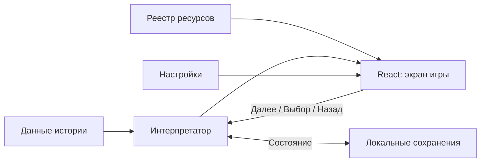

# Архитектура будущей веб-версии

Обновление: создан ограниченный [интерфейсный прототип](INTERFACE.md) на выбранном стеке с тремя оформлениями. План ниже относится к полному переносу; текущая реализация показывает только первый выбор четырёх глав и ответную реплику.

## Решение

Предлагаю **React + TypeScript + Vite**, отдельный небольшой интерпретатор сценария и статические ресурсы. Всё исполняется в браузере; результат сборки размещается на GitHub Pages. Сюжет хранится как данные, поэтому новую шутку или ветку можно добавлять без изменения React-компонентов.

React отвечает за экран, меню и настройки. Логика прохождения не привязана к React: чистые функции принимают состояние и действие и возвращают новое состояние. Для подключения к UI достаточно `useReducer`; отдельная библиотека глобального состояния на этом масштабе не нужна. Это проектное решение опирается на [модель reducer в React](https://react.dev/learn/managing-state).

## Границы модулей



Ниже — **планируемая** структура, этих модулей сейчас ещё нет:

```text
src/
  app/                      запуск, переключение экранов, обработка ошибок
  engine/
    types.ts                контракт сценария, состояния и действий
    interpreter.ts          исполнение команд до следующего текста или меню
    reducer.ts              next, choose, rollback, restart, load
    validateStory.ts        ссылки, уникальность ID, ресурсы, достижимость
  content/
    story.ts                сборка глав в одну историю
    chapters/               главы: приезд, наземка, жигули, Трава, ФАПы
    assets.ts               логический ID → точный путь и метаданные
  features/
    player/                 GameScreen, SceneImage, DialogueBox, ChoiceList
    menu/                   начальное меню и выбор главы
    saves/                  запись, чтение, миграции localStorage
    settings/               скорость текста, размер шрифта, звук в будущем
    history/                журнал прочитанного и откат
  styles/                   стили и адаптация под телефон
public/
  assets/images/            подготовленные копии иллюстраций
  assets/ui/                нужные элементы интерфейса
```

`source/` останется архивом исходников, `docs/` — документацией, `tools/` — инструментами. Архив, старые `.rpyc`, отчёты и сохранения Ren’Py не должны попадать в `dist/`. На этом этапе нет смысла переносить весь стандартный интерфейс Ren’Py или его 78 картинок в публичную сборку автоматически.

## Формат истории

Текущий `content/story.extracted.json` — промежуточное представление для переноса и проверки. Он сохраняет исходную вложенность; `line-*` — ссылки на строки, которые меняются при редактировании оригинала. Для рабочего контента нужны **стабильные осмысленные ID** и `schemaVersion` / `storyVersion`.

Предлагаемые команды:

| Тип | Данные | Поведение |
| --- | --- | --- |
| `scene` | `assetId` | Сменить фон и продолжить исполнение |
| `text` | `id`, `text`, необязательный `speakerId` | Показать реплику, ждать «Далее» |
| `choice` | `id`, необязательная подпись, список `options` | Ждать выбора |
| `jump` | `targetLabel` | Продолжить с другого блока |
| `end` | необязательный `endingId` | Завершить историю |

У каждого варианта есть собственные `id`, `text`, `steps`. `steps` — последовательность тех же команд, включая новое меню. Это сохраняет вложенные уговоры и реплики непосредственно внутри вариантов. Интерпретатор держит стек продолжений: закончив вложенную последовательность, возвращается в родительскую; `jump` заменяет текущий путь. Не нужно полагаться только на номер реплики внутри главы.

В исходном сюжете нет `call` и переменных состояния. На первом этапе исходные `return` можно отображать в `end` только после проверки пути: общий механизм `call` добавлять сейчас незачем. При исчерпании блока надо явно сохранить исходное последовательное прохождение к следующему `label`, если до него реально можно дойти; нельзя считать всякую границу `label` автоматической концовкой. Непроходимые `return` после безусловных `jump` можно оставить в промежуточном архиве.

Нужен лимит автоматических команд между пользовательскими остановками, чтобы случайный цикл из одних `jump` не подвесил вкладку. Игровые циклы через меню, например повтор дня на ФАПах, остаются разрешены.

Строки выводить как текст React. Если позже понадобятся теги оформления Ren’Py, реализовать отдельный ограниченный формат; сейчас не использовать `eval` и не вставлять сюжет через `dangerouslySetInnerHTML`.

## Состояние и сохранения

Минимальное состояние: версия истории, текущий блок, стабильный ID ожидающей команды, стек продолжений, фон, журнал прочитанного и история снимков для отката. Картинки в состояние не копируются — только их ID.

Снимок сохранения записывает состояние и версию формата. Автосохранение делается на устойчивых остановках: показ текста или ожидание выбора. Ручные слоты можно добавить поверх того же адаптера. Настройки хранятся отдельно. Некорректный JSON, несовместимая версия или недоступное хранилище дают понятное сообщение и возможность начать заново, а не ломают запуск. Синхронизации между устройствами без сервера не будет; при желании добавить экспорт и импорт сохранения файлом.

Откат должен восстанавливать и текст, и фон, и выбранную ветку. Новая ветка после отката обрезает прежнее будущее. Кнопка «Далее» не должна случайно выбирать первый пункт меню; повторные нажатия на уже выбранный вариант игнорируются.

## Изображения и экран

Оригиналы сохраняются неизменными. Для публикации позже создать отдельные облегчённые копии WebP, сравнив читаемость лиц и мелких надписей. В `assets.ts` использовать короткие стабильные ID, а пути брать из реестра с учётом регистра расширений. Пути с пробелами и `.PNG` не исправлять в архиве; при подготовке веб-копий можно дать им простые имена.

На телефоне — вертикальная композиция с текстом и крупными вариантами, на широком экране — ограниченная ширина сцены и место для текста рядом или снизу. Изображение показывать целиком; оригинальное 1200 × 1600 — ориентир для композиции, а не обязательный размер окна. Предзагружать текущую и ближайшие доступные сцены, не весь каталог.

В первой версии: нажатие и Space/Enter для следующего текста, доступные кнопки выбора, заметный фокус, настройки размера текста и мгновенного показа, режим reduced motion. Звуковой модуль можно подключить позже, поскольку звуковых материалов сейчас нет.

## GitHub Pages

Публикуется только `dist/`, полученный сборкой Vite через GitHub Actions. Для адреса `https://user.github.io/repository/` нужно настроить `base: '/repository/'`; для корневого домена — `/`. Все пути ресурсов строить с учётом `import.meta.env.BASE_URL`, не через жёсткий `/assets/...`. Это следует из [официального руководства Vite по GitHub Pages](https://vite.dev/guide/static-deploy#github-pages).

Для одной новеллы URL-маршрутизация не обязательна: меню, игра и настройки можно переключать внутри приложения. Если позже понадобятся ссылки на главы, использовать hash URL, чтобы обновление страницы не требовало серверной обработки маршрута.

Рабочий репозиторий может содержать архив и документацию; опубликованная сборка содержит только приложение и используемые ресурсы. Создание репозитория, настройка Actions и публикация относятся к следующему этапу.

## Порядок реализации после согласования плана

1. Пройти сценарий по выгрузке, решить вопрос с отсутствующей картинкой и начальным меню. Зафиксировать точный перенос как первый вариант истории.
2. Подготовить рабочий формат со стабильными ID и реестром ресурсов. Сверить количество и содержание всех 55 вариантов, вложенность, 47 переходов и порядок сцен.
3. Создать интерпретатор и проверить ветвление, вложенные меню, намеренные циклы, завершение и откат. Проверка должна включать все варианты, а не только «удачный» маршрут.
4. Подключить React-экран и адаптивную вёрстку, затем локальные сохранения и настройки.
5. Подготовить изображения для веба, проверить пути в локальной сборке с префиксом репозитория, затем на GitHub Pages и телефонах.
6. После сохранения исходной версии добавлять новые эпизоды, альтернативные последствия и иллюстрации отдельными изменениями.

## Иллюстрации для доработки

Первая необходимая сцена — возвращение Ярика на жигулях (`yarik na zhige`). Следующие кандидаты — две закомментированные сцены с конурой и пробуждением Алика. Остальные добавления лучше выбирать после просмотра галереи и чтения эпизодов.

Для новых картинок подготовить визуальную памятку: облик персонажей, одежда, узнаваемые места, стиль коллажа и расположение текста. Можно генерировать новые иллюстрации и редактировать существующие по референсам. Для узнаваемости друзей нужны подходящие исходные фотографии; точное сходство и постоянство персонажей проверяются по результатам. Вертикальный кадр около 3:4 согласуется с большинством текущих сцен.
