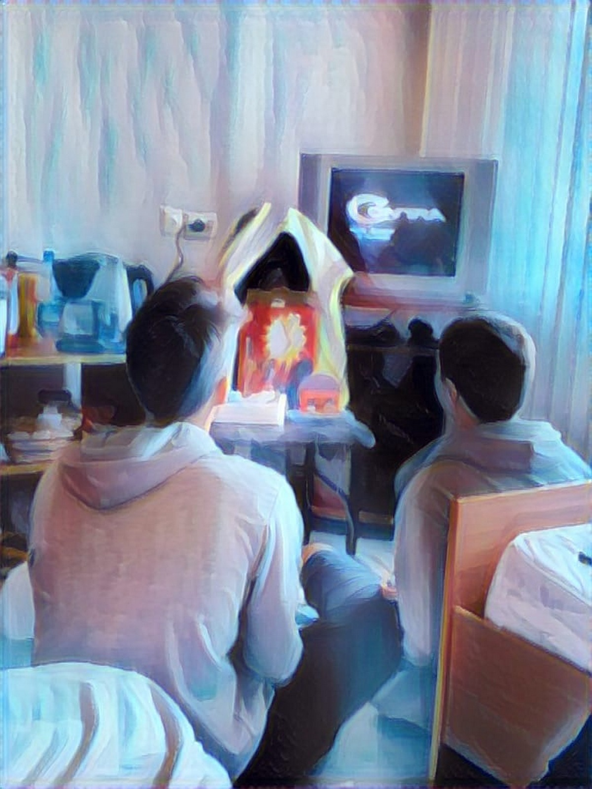
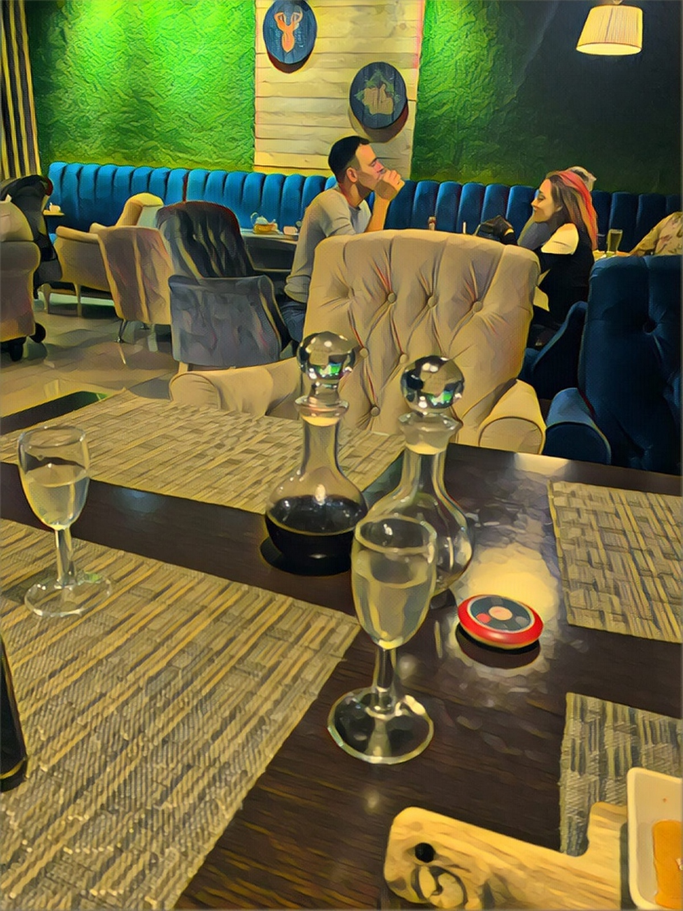
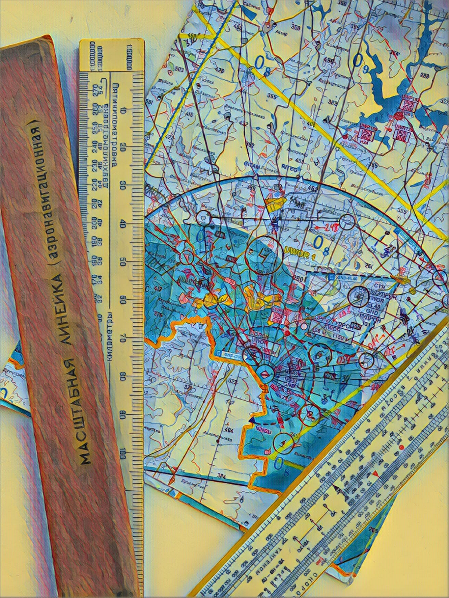
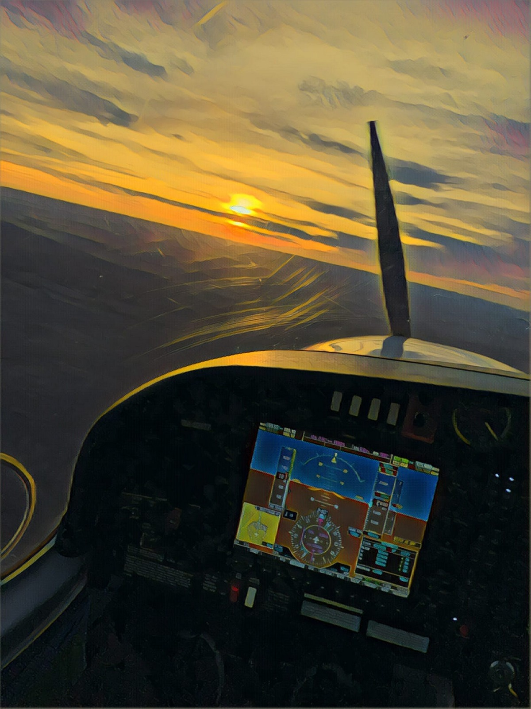
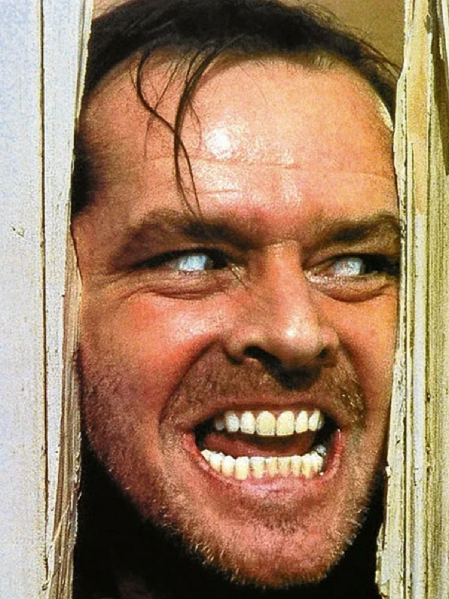
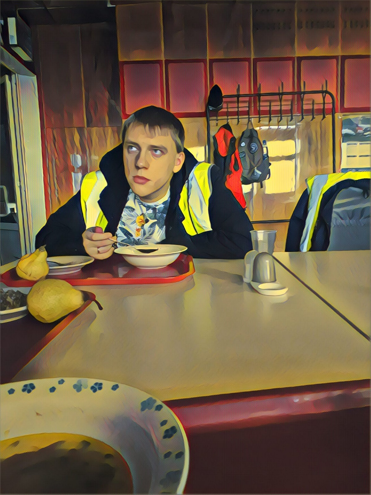
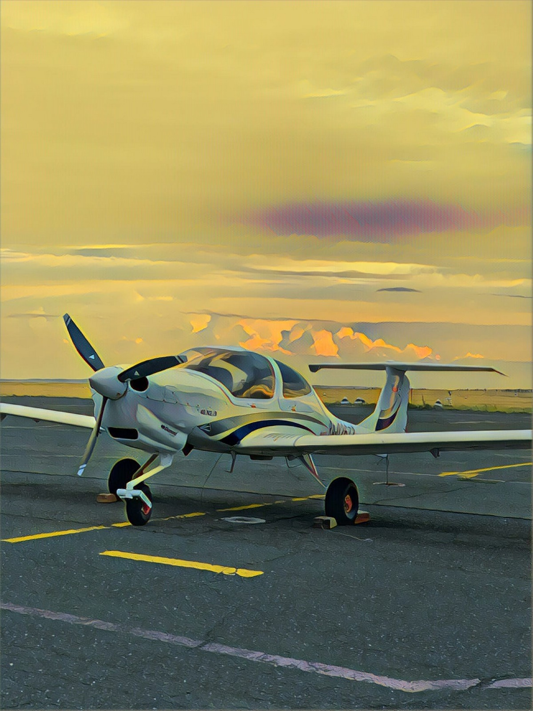
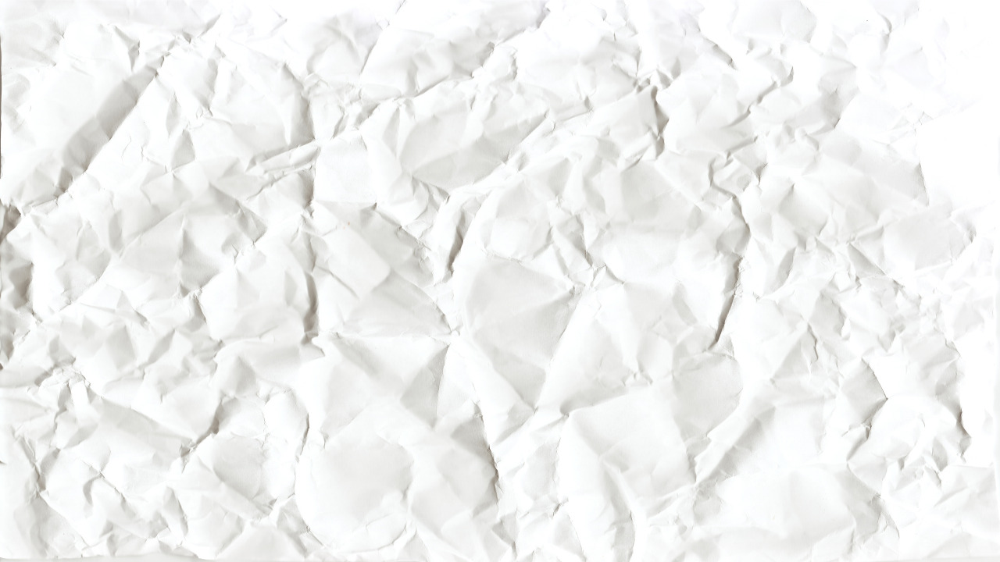

# Каталог ресурсов

Оригинальные файлы сохранены без конвертации. Размеры: ширина × высота. Имя Ren’Py определяется именем файла без расширения; папка `bg` сама по себе не добавляет префикс `bg`.

| Файл | Категория | Размеры | Использование в сценарии |
| --- | --- | --- | --- |
| [gui/bar/bottom.png](../source/renpy/game/gui/bar/bottom.png) | gui | 25 × 777 | — |
| [gui/bar/left.png](../source/renpy/game/gui/bar/left.png) | gui | 777 × 25 | — |
| [gui/bar/right.png](../source/renpy/game/gui/bar/right.png) | gui | 777 × 25 | — |
| [gui/bar/top.png](../source/renpy/game/gui/bar/top.png) | gui | 25 × 777 | — |
| [gui/button/check_foreground.png](../source/renpy/game/gui/button/check_foreground.png) | gui | 18 × 73 | — |
| [gui/button/check_selected_foreground.png](../source/renpy/game/gui/button/check_selected_foreground.png) | gui | 18 × 73 | — |
| [gui/button/choice_hover_background.png](../source/renpy/game/gui/button/choice_hover_background.png) | gui | 740 × 32 | — |
| [gui/button/choice_idle_background.png](../source/renpy/game/gui/button/choice_idle_background.png) | gui | 740 × 32 | — |
| [gui/button/hover_background.png](../source/renpy/game/gui/button/hover_background.png) | gui | 666 × 73 | — |
| [gui/button/idle_background.png](../source/renpy/game/gui/button/idle_background.png) | gui | 666 × 73 | — |
| [gui/button/quick_hover_background.png](../source/renpy/game/gui/button/quick_hover_background.png) | gui | 93 × 28 | — |
| [gui/button/quick_idle_background.png](../source/renpy/game/gui/button/quick_idle_background.png) | gui | 93 × 28 | — |
| [gui/button/radio_foreground.png](../source/renpy/game/gui/button/radio_foreground.png) | gui | 18 × 73 | — |
| [gui/button/radio_selected_foreground.png](../source/renpy/game/gui/button/radio_selected_foreground.png) | gui | 18 × 73 | — |
| [gui/button/slot_hover_background.png](../source/renpy/game/gui/button/slot_hover_background.png) | gui | 276 × 206 | — |
| [gui/button/slot_idle_background.png](../source/renpy/game/gui/button/slot_idle_background.png) | gui | 276 × 206 | — |
| [gui/frame.png](../source/renpy/game/gui/frame.png) | gui | 562 × 234 | — |
| [gui/game_menu.png](../source/renpy/game/gui/game_menu.png) | gui | 1280 × 720 | — |
| [gui/main_menu.png](../source/renpy/game/gui/main_menu.png) | gui | 1280 × 720 | — |
| [gui/namebox.png](../source/renpy/game/gui/namebox.png) | gui | 281 × 33 | — |
| [gui/notify.png](../source/renpy/game/gui/notify.png) | gui | 864 × 40 | — |
| [gui/nvl.png](../source/renpy/game/gui/nvl.png) | gui | 1200 × 1600 | — |
| [gui/overlay/confirm.png](../source/renpy/game/gui/overlay/confirm.png) | gui | 1200 × 1600 | — |
| [gui/overlay/game_menu.png](../source/renpy/game/gui/overlay/game_menu.png) | gui | 1200 × 1600 | — |
| [gui/overlay/main_menu.png](../source/renpy/game/gui/overlay/main_menu.png) | gui | 1200 × 1600 | — |
| [gui/phone/bar/bottom.png](../source/renpy/game/gui/phone/bar/bottom.png) | gui | 25 × 777 | — |
| [gui/phone/bar/left.png](../source/renpy/game/gui/phone/bar/left.png) | gui | 777 × 25 | — |
| [gui/phone/bar/right.png](../source/renpy/game/gui/phone/bar/right.png) | gui | 777 × 25 | — |
| [gui/phone/bar/top.png](../source/renpy/game/gui/phone/bar/top.png) | gui | 25 × 777 | — |
| [gui/phone/button/check_foreground.png](../source/renpy/game/gui/phone/button/check_foreground.png) | gui | 18 × 95 | — |
| [gui/phone/button/check_selected_foreground.png](../source/renpy/game/gui/phone/button/check_selected_foreground.png) | gui | 18 × 95 | — |
| [gui/phone/button/choice_hover_background.png](../source/renpy/game/gui/phone/button/choice_hover_background.png) | gui | 740 × 32 | — |
| [gui/phone/button/choice_idle_background.png](../source/renpy/game/gui/phone/button/choice_idle_background.png) | gui | 740 × 32 | — |
| [gui/phone/button/hover_background.png](../source/renpy/game/gui/phone/button/hover_background.png) | gui | 666 × 95 | — |
| [gui/phone/button/idle_background.png](../source/renpy/game/gui/phone/button/idle_background.png) | gui | 666 × 95 | — |
| [gui/phone/button/radio_foreground.png](../source/renpy/game/gui/phone/button/radio_foreground.png) | gui | 18 × 95 | — |
| [gui/phone/button/radio_selected_foreground.png](../source/renpy/game/gui/phone/button/radio_selected_foreground.png) | gui | 18 × 95 | — |
| [gui/phone/button/slot_hover_background.png](../source/renpy/game/gui/phone/button/slot_hover_background.png) | gui | 276 × 206 | — |
| [gui/phone/button/slot_idle_background.png](../source/renpy/game/gui/phone/button/slot_idle_background.png) | gui | 276 × 206 | — |
| [gui/phone/nvl.png](../source/renpy/game/gui/phone/nvl.png) | gui | 1200 × 1600 | — |
| [gui/phone/overlay/game_menu.png](../source/renpy/game/gui/phone/overlay/game_menu.png) | gui | 1200 × 1600 | — |
| [gui/phone/overlay/main_menu.png](../source/renpy/game/gui/phone/overlay/main_menu.png) | gui | 1200 × 1600 | — |
| [gui/phone/scrollbar/horizontal_hover_bar.png](../source/renpy/game/gui/phone/scrollbar/horizontal_hover_bar.png) | gui | 1555 × 12 | — |
| [gui/phone/scrollbar/horizontal_hover_thumb.png](../source/renpy/game/gui/phone/scrollbar/horizontal_hover_thumb.png) | gui | 1555 × 12 | — |
| [gui/phone/scrollbar/horizontal_idle_bar.png](../source/renpy/game/gui/phone/scrollbar/horizontal_idle_bar.png) | gui | 1555 × 12 | — |
| [gui/phone/scrollbar/horizontal_idle_thumb.png](../source/renpy/game/gui/phone/scrollbar/horizontal_idle_thumb.png) | gui | 1555 × 12 | — |
| [gui/phone/scrollbar/vertical_hover_bar.png](../source/renpy/game/gui/phone/scrollbar/vertical_hover_bar.png) | gui | 12 × 1555 | — |
| [gui/phone/scrollbar/vertical_hover_thumb.png](../source/renpy/game/gui/phone/scrollbar/vertical_hover_thumb.png) | gui | 12 × 1555 | — |
| [gui/phone/scrollbar/vertical_idle_bar.png](../source/renpy/game/gui/phone/scrollbar/vertical_idle_bar.png) | gui | 12 × 1555 | — |
| [gui/phone/scrollbar/vertical_idle_thumb.png](../source/renpy/game/gui/phone/scrollbar/vertical_idle_thumb.png) | gui | 12 × 1555 | — |
| [gui/phone/slider/horizontal_hover_bar.png](../source/renpy/game/gui/phone/slider/horizontal_hover_bar.png) | gui | 777 × 36 | — |
| [gui/phone/slider/horizontal_hover_thumb.png](../source/renpy/game/gui/phone/slider/horizontal_hover_thumb.png) | gui | 33 × 36 | — |
| [gui/phone/slider/horizontal_idle_bar.png](../source/renpy/game/gui/phone/slider/horizontal_idle_bar.png) | gui | 777 × 36 | — |
| [gui/phone/slider/horizontal_idle_thumb.png](../source/renpy/game/gui/phone/slider/horizontal_idle_thumb.png) | gui | 33 × 36 | — |
| [gui/phone/slider/vertical_hover_bar.png](../source/renpy/game/gui/phone/slider/vertical_hover_bar.png) | gui | 36 × 777 | — |
| [gui/phone/slider/vertical_hover_thumb.png](../source/renpy/game/gui/phone/slider/vertical_hover_thumb.png) | gui | 36 × 33 | — |
| [gui/phone/slider/vertical_idle_bar.png](../source/renpy/game/gui/phone/slider/vertical_idle_bar.png) | gui | 36 × 777 | — |
| [gui/phone/slider/vertical_idle_thumb.png](../source/renpy/game/gui/phone/slider/vertical_idle_thumb.png) | gui | 36 × 33 | — |
| [gui/phone/textbox.png](../source/renpy/game/gui/phone/textbox.png) | gui | 1200 × 225 | — |
| [gui/scrollbar/horizontal_hover_bar.png](../source/renpy/game/gui/scrollbar/horizontal_hover_bar.png) | gui | 1555 × 12 | — |
| [gui/scrollbar/horizontal_hover_thumb.png](../source/renpy/game/gui/scrollbar/horizontal_hover_thumb.png) | gui | 1555 × 12 | — |
| [gui/scrollbar/horizontal_idle_bar.png](../source/renpy/game/gui/scrollbar/horizontal_idle_bar.png) | gui | 1555 × 12 | — |
| [gui/scrollbar/horizontal_idle_thumb.png](../source/renpy/game/gui/scrollbar/horizontal_idle_thumb.png) | gui | 1555 × 12 | — |
| [gui/scrollbar/vertical_hover_bar.png](../source/renpy/game/gui/scrollbar/vertical_hover_bar.png) | gui | 12 × 1555 | — |
| [gui/scrollbar/vertical_hover_thumb.png](../source/renpy/game/gui/scrollbar/vertical_hover_thumb.png) | gui | 12 × 1555 | — |
| [gui/scrollbar/vertical_idle_bar.png](../source/renpy/game/gui/scrollbar/vertical_idle_bar.png) | gui | 12 × 1555 | — |
| [gui/scrollbar/vertical_idle_thumb.png](../source/renpy/game/gui/scrollbar/vertical_idle_thumb.png) | gui | 12 × 1555 | — |
| [gui/skip.png](../source/renpy/game/gui/skip.png) | gui | 225 × 40 | — |
| [gui/slider/horizontal_hover_bar.png](../source/renpy/game/gui/slider/horizontal_hover_bar.png) | gui | 777 × 25 | — |
| [gui/slider/horizontal_hover_thumb.png](../source/renpy/game/gui/slider/horizontal_hover_thumb.png) | gui | 22 × 25 | — |
| [gui/slider/horizontal_idle_bar.png](../source/renpy/game/gui/slider/horizontal_idle_bar.png) | gui | 777 × 25 | — |
| [gui/slider/horizontal_idle_thumb.png](../source/renpy/game/gui/slider/horizontal_idle_thumb.png) | gui | 22 × 25 | — |
| [gui/slider/vertical_hover_bar.png](../source/renpy/game/gui/slider/vertical_hover_bar.png) | gui | 25 × 777 | — |
| [gui/slider/vertical_hover_thumb.png](../source/renpy/game/gui/slider/vertical_hover_thumb.png) | gui | 25 × 22 | — |
| [gui/slider/vertical_idle_bar.png](../source/renpy/game/gui/slider/vertical_idle_bar.png) | gui | 25 × 777 | — |
| [gui/slider/vertical_idle_thumb.png](../source/renpy/game/gui/slider/vertical_idle_thumb.png) | gui | 25 × 22 | — |
| [gui/textbox.png](../source/renpy/game/gui/textbox.png) | gui | 1200 × 173 | — |
| [gui/window_icon.png](../source/renpy/game/gui/window_icon.png) | gui | 250 × 250 | — |
| [images/back/back orskroom.png](../source/renpy/game/images/back/back%20orskroom.png) | images | 1280 × 720 | — |
| [images/bg/bg akashevclass.jpg](../source/renpy/game/images/bg/bg%20akashevclass.jpg) | images | 1200 × 1600 | 152, 226 |
| [images/bg/bg alik yarik v trusah.jpg](../source/renpy/game/images/bg/bg%20alik%20yarik%20v%20trusah.jpg) | images | 1312 × 1750 | 87 |
| [images/bg/bg alikspit.jpg](../source/renpy/game/images/bg/bg%20alikspit.jpg) | images | 1200 × 1600 | 140 |
| [images/bg/bg komnata buhali noch.jpg](../source/renpy/game/images/bg/bg%20komnata%20buhali%20noch.jpg) | images | 1312 × 1750 | 284 |
| [images/bg/bg komnata buhat1.jpg](../source/renpy/game/images/bg/bg%20komnata%20buhat1.jpg) | images | 1200 × 1600 | 286 |
| [images/bg/bg orsk tower1.jpg](../source/renpy/game/images/bg/bg%20orsk%20tower1.jpg) | images | 1200 × 1601 | 43 |
| [images/bg/bg orsk vid1.jpg](../source/renpy/game/images/bg/bg%20orsk%20vid1.jpg) | images | 1312 × 1750 | 39 |
| [images/bg/bg orskroom.png](../source/renpy/game/images/bg/bg%20orskroom.png) | images | 1280 × 720 | — |
| [images/bg/bg polina_anya.jpg](../source/renpy/game/images/bg/bg%20polina_anya.jpg) | images | 1200 × 1600 | 47 |
| [images/bg/bg preispodnyaa.jpg](../source/renpy/game/images/bg/bg%20preispodnyaa.jpg) | images | 1200 × 1600 | 123 |
| [images/bg/bg start.jpg](../source/renpy/game/images/bg/bg%20start.jpg) | images | 512 × 352 | — |
| [images/bg/bg tsigani anya.PNG](../source/renpy/game/images/bg/bg%20tsigani%20anya.PNG) | images | 1200 × 1600 | 117 |
| [images/bg/bg vilam dver.jpg](../source/renpy/game/images/bg/bg%20vilam%20dver.jpg) | images | 1312 × 1751 | 148 |
| [images/bg/bg yarik pivo.jpg](../source/renpy/game/images/bg/bg%20yarik%20pivo.jpg) | images | 1200 × 1600 | 111 |
| [images/bg/bg yarik predlagaet mashinu.jpg](../source/renpy/game/images/bg/bg%20yarik%20predlagaet%20mashinu.jpg) | images | 1312 × 1750 | 293 |
| [images/bg/dendy.jpg](../source/renpy/game/images/bg/dendy.jpg) | images | 1200 × 1600 | 282 |
| [images/bg/devki zhdut.jpg](../source/renpy/game/images/bg/devki%20zhdut.jpg) | images | 1200 × 1600 | 487 |
| [images/bg/devki zhiga.jpg](../source/renpy/game/images/bg/devki%20zhiga.jpg) | images | 1200 × 1600 | 364 |
| [images/bg/eto akashev.jpg](../source/renpy/game/images/bg/eto%20akashev.jpg) | images | 1200 × 1600 | 449 |
| [images/bg/limonchella.jpg](../source/renpy/game/images/bg/limonchella.jpg) | images | 1200 × 1600 | 366 |
| [images/bg/litso alik1.jpg](../source/renpy/game/images/bg/litso%20alik1.jpg) | images | 1200 × 1600 | 466 |
| [images/bg/litso alik2.jpg](../source/renpy/game/images/bg/litso%20alik2.jpg) | images | 1200 × 1600 | 468 |
| [images/bg/main_menu.png](../source/renpy/game/images/bg/main_menu.png) | images | 1200 × 1600 | 18 |
| [images/bg/moet samolet.jpg](../source/renpy/game/images/bg/moet%20samolet.jpg) | images | 1200 × 1600 | 362 |
| [images/bg/polet.jpg](../source/renpy/game/images/bg/polet.jpg) | images | 1200 × 1601 | 330 |
| [images/bg/sazhaet samolet.jpg](../source/renpy/game/images/bg/sazhaet%20samolet.jpg) | images | 1200 × 1600 | 332 |
| [images/bg/siyaniye.PNG](../source/renpy/game/images/bg/siyaniye.PNG) | images | 1200 × 1600 | 521, 531, 541 |
| [images/bg/stolovaya.jpg](../source/renpy/game/images/bg/stolovaya.jpg) | images | 1200 × 1600 | 507 |
| [images/bg/stoyanka.jpg](../source/renpy/game/images/bg/stoyanka.jpg) | images | 1200 × 1600 | 276 |
| [images/bg/vishli poparit.jpg](../source/renpy/game/images/bg/vishli%20poparit.jpg) | images | 1200 × 1600 | 464 |
| [images/bg/yarik slomalya.jpg](../source/renpy/game/images/bg/yarik%20slomalya.jpg) | images | 1200 × 1600 | 474 |
| [images/paper/paper.jpg](../source/renpy/game/images/paper/paper.jpg) | images | 1280 × 720 | — |
| [images/pidors/pidor yarik.jpg](../source/renpy/game/images/pidors/pidor%20yarik.jpg) | images | 499 × 500 | — |

## Иллюстрации

### back orskroom

### bg akashevclass

### bg alik yarik v trusah

### bg alikspit

### bg komnata buhali noch

### bg komnata buhat1

### bg orsk tower1

### bg orsk vid1

### bg orskroom

### bg polina_anya

### bg preispodnyaa

### bg start

### bg tsigani anya

### bg vilam dver

### bg yarik pivo

### bg yarik predlagaet mashinu

### dendy

### devki zhdut

### devki zhiga

### eto akashev

### limonchella

### litso alik1

### litso alik2

### main_menu

### moet samolet

### polet

### sazhaet samolet

### siyaniye

### stolovaya

### stoyanka

### vishli poparit

### yarik slomalya

### paper

### pidor yarik

