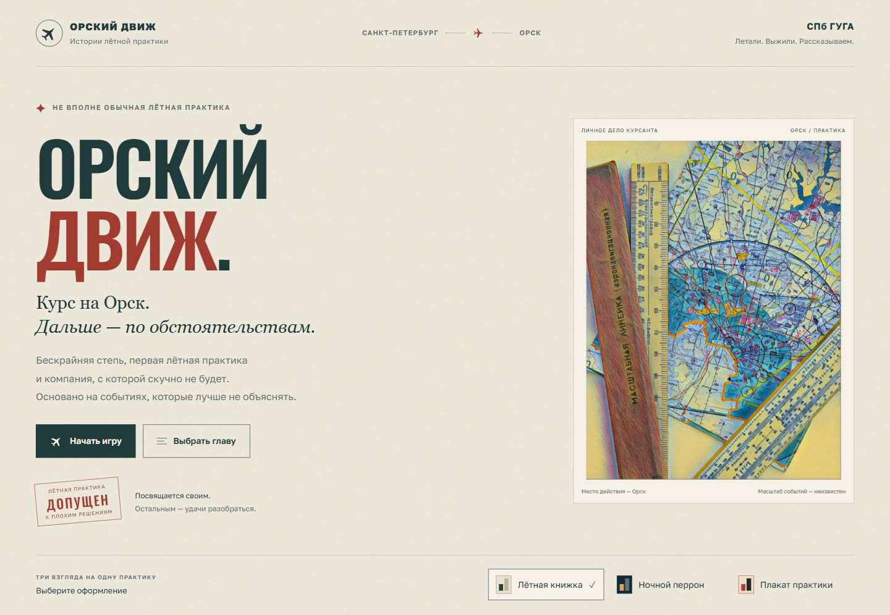
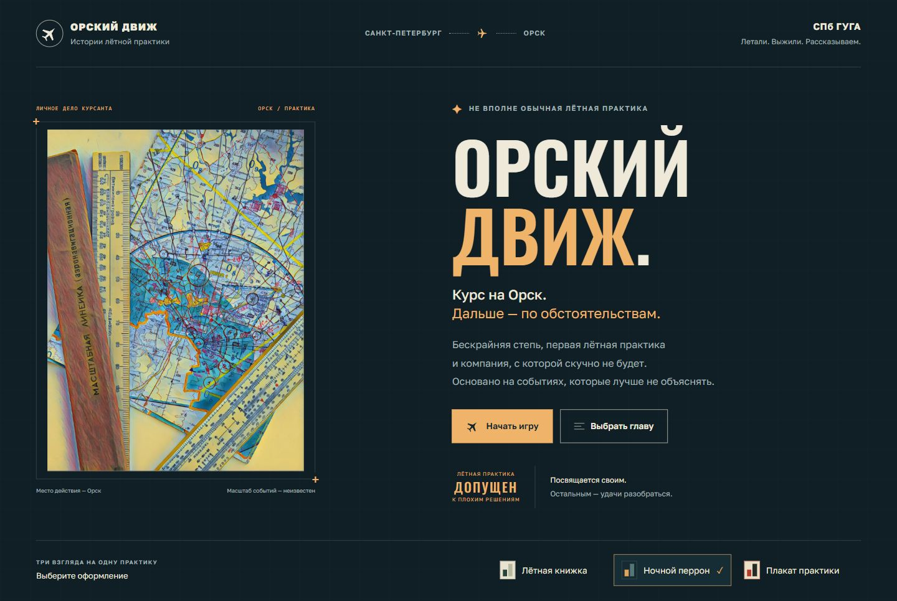
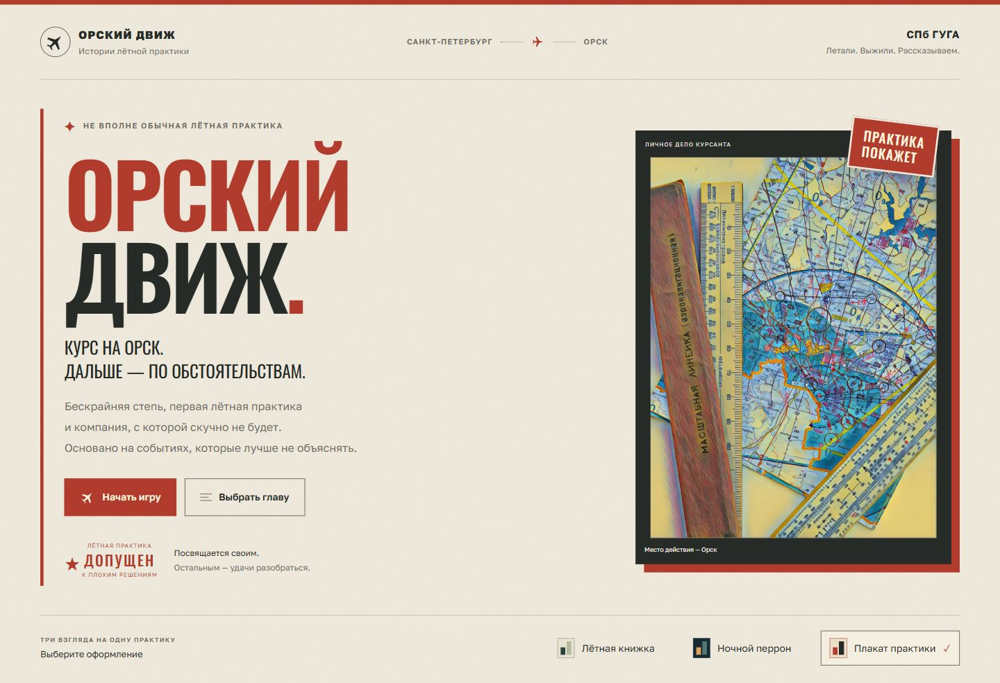
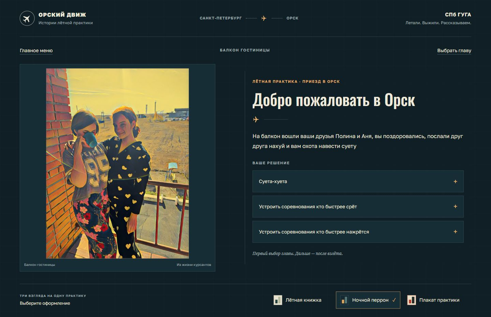
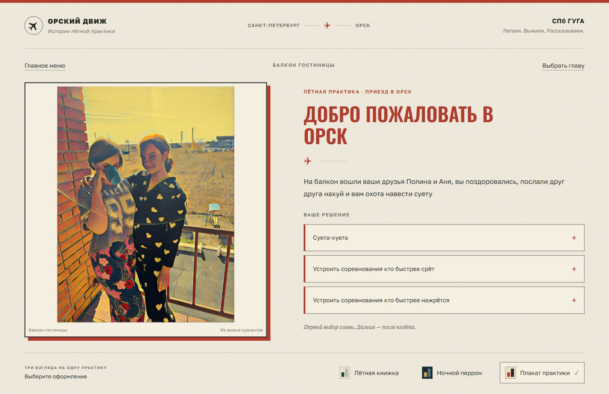

# Прототип: три оформления

Интерфейс создан заново на React + TypeScript + Vite. Оригинальный GUI Ren’Py сохранён только в архиве; в веб-версию он не копируется.

## Визуальные направления

| Вариант | Характер | Детали |
| --- | --- | --- |
| Лётная книжка | Светлый, спокойный, похож на личное дело курсанта | Тёплая бумага, тёмный бирюзовый, кирпичный красный, засечки в подзаголовке, рамка фотографии и штамп |
| Ночной перрон | Тёмный и более кинематографичный | Сине-зелёный фон, приборная сетка, янтарные акценты, фотография слева, текст справа |
| Плакат практики | Контрастный, с самым заметным советским флёром | Красная вертикаль, плотная плакатная типографика, звезда, плашка «Практика покажет» и смещённая рамка |

Палитра взята из самих иллюстраций: золотистый свет, бирюзовые и сине-зелёные участки, красный кирпич. На фотографии не накладываются дополнительные цветовые фильтры. Все изображения показываются целиком через `object-fit: contain`. Обложка — именно `images/bg/main_menu.png` с картой и навигационными линейками.

Шрифты Golos Text и Oswald установлены локально через Fontsource и включаются в сборку. Приложение не обращается к Google Fonts или внешнему API.

## Снимки интерфейса

### Лётная книжка

### Ночной перрон

### Плакат практики

### Игровая сцена

## Что можно проверить

- «Начать игру» открывает первый выбор начала истории (`startt`): встречу на балконе с Полиной и Аней.
- «Выбрать главу» открывает модальное окно с четырьмя пунктами. Это те же точки входа, что в исходном стартовом меню: начало, `viotsidelli`, `dalee`, `gostichkayarik`.
- Для каждой главы показаны оригинальная иллюстрация перед первым меню, подпись меню, все его варианты и первая исходная ответная реплика после выбора.
- После ответа можно попробовать другой вариант, выбрать главу или вернуться в главное меню.
- Оформление переключается без сброса открытой главы и текущего ответа; сохраняется после обновления страницы.
- Диалог закрывается крестиком, Escape или нажатием вне окна. Есть фокус с клавиатуры и ссылки пропуска шапки.
- На узком экране обложка остаётся рядом с названием, кнопки доступны ниже, игровая иллюстрация целиком вписывается по высоте. Вёрстка не требует обрезки исходных фотографий.

## Границы текущей реализации

Это визуальная проба первого выбора, а не полный проигрыватель Ren’Py. Последовательность вступительных реплик до меню временно свёрнута до первой развилки. После первой ответной реплики сюжет останавливается; вложенное меню или переход в следующую сцену ещё не проигрываются. Тексты берутся из структурной выгрузки автоматически, без переписывания шуток и без изменения исходника. Названия глав, заставочные надписи и поясняющие подписи интерфейса новые.

Нет сохранений прохождения, звука, полного отката и публикации. Сохраняется только выбранный визуальный стиль. Если браузер запрещает локальное хранилище, переключение продолжает работать в текущей сессии.

## Организация кода

`src/main.tsx` содержит экран меню, первую игровую развилку, модальное окно и переключатель стилей. `src/styles.css` содержит базовую вёрстку, три визуальные темы и адаптацию. На таком размере нет необходимости заранее дробить каждую кнопку в отдельный файл.

`tools/prepare-preview.mjs` читает `content/story.extracted.json` и `content/assets.json`, выбирает первое меню каждой из четырёх глав и копирует только пять нужных изображений в `public/assets/images/`. Он создаёт `src/content/preview.json` перед запуском и сборкой. Тексты и принадлежность вариантов к меню остаются связанными с оригиналом через номера строк. При изменении архивной выгрузки нужно запустить подготовку ещё раз.

Дальнейшее расширение интерпретатора и разделение на модули описаны в [архитектуре](ARCHITECTURE.md). После выбора визуального направления можно убрать переключатель вариантов и переносить последовательное прохождение без пересборки дизайна с нуля.

## Проверка

`npm run build` выполнен успешно: проверка TypeScript и статическая сборка Vite. В браузере проверены начало, все четыре главы, оригинальные ответы на выборы, переключение оформления с сохранением текущего ответа, сохранение оформления после обновления, закрытие окна глав по Escape и отсутствие ошибок приложения в консоли. Проверена узкая компоновка около 390–430 CSS-пикселей и широкая; горизонтального переполнения на узком экране нет.

Пять изображений в `dist/` совпадают с оригиналами по SHA-256. Исходники Ren’Py, сохранения и GUI в публичную сборку не попали. Публикация на GitHub Pages ещё не выполнялась.
